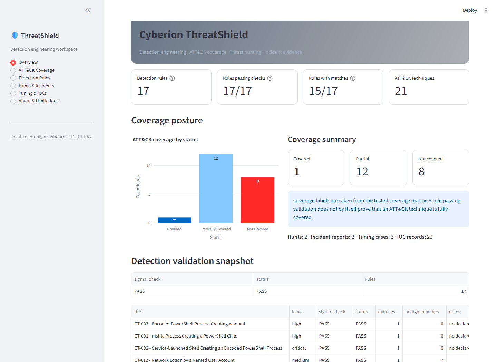
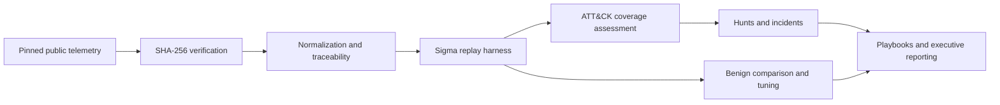
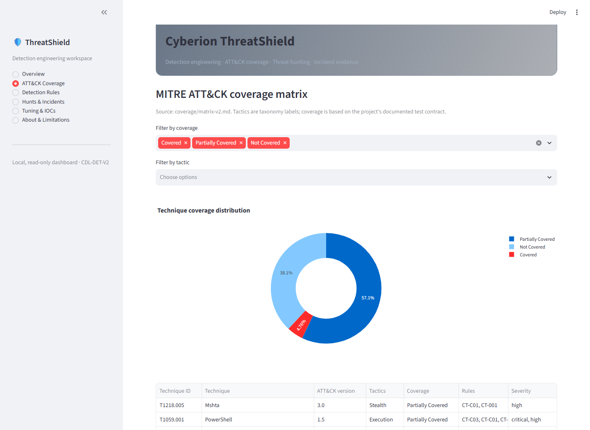
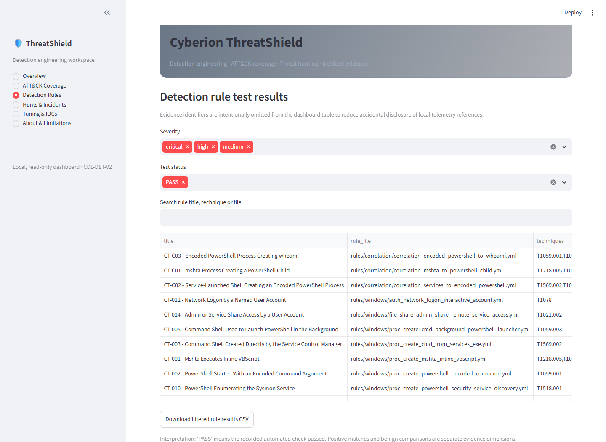
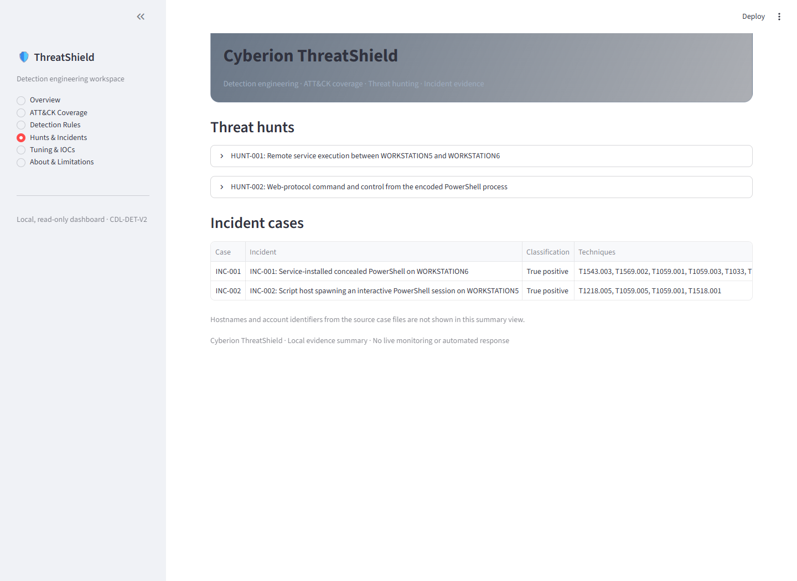
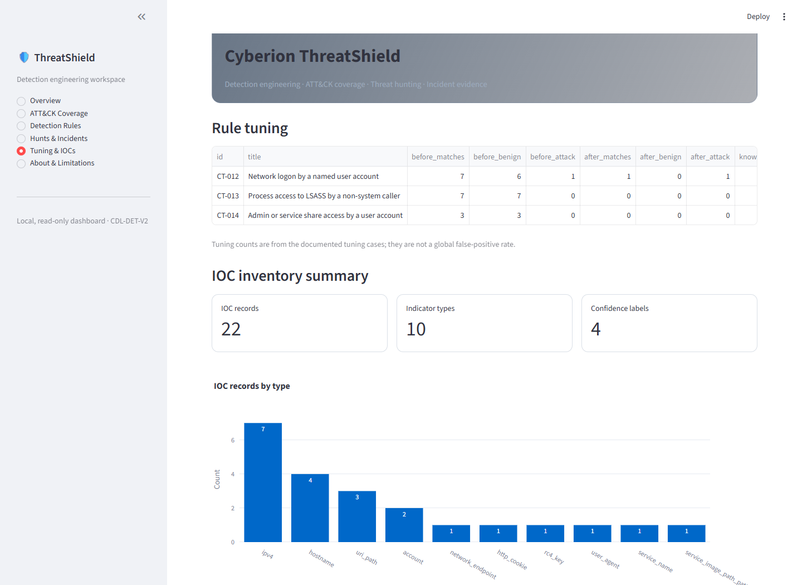

# Cyberion ThreatShield

[](https://github.com/Rugved-24/Cyberion-ThreatShield/actions/workflows/ci.yml)


**Evidence-driven detection engineering that proves what a rule can detect—and
reports what it cannot.**

Cyberion ThreatShield is an end-to-end blue-team research project that turns
public Windows telemetry into reproducible Sigma validation, ATT&CK coverage,
threat hunts, incident reconstructions, IOC research and response playbooks. It
is designed around defensible evidence rather than inflated rule counts.



## Why this project stands out

Many detection repositories stop after a rule parses successfully. ThreatShield
goes further: each coverage claim is tied to a telemetry replay, traceable event
evidence and a measured benign comparison. Negative results remain visible, raw
input integrity is enforced with SHA-256, and reporting is regenerated from the
same evidence used by the test harness.

| Typical rule repository | Cyberion ThreatShield |
| --- | --- |
| Syntax validation | Syntax plus replay against real attack telemetry |
| Counts rules as coverage | Separates rule PASS from empirical ATT&CK coverage |
| Gaps are easy to hide | Covered, Partial and Not Covered are reported explicitly |
| Manual screenshots and claims | Generated evidence, matrices and status reports |
| Unclear data provenance | Pinned sources, byte counts and SHA-256 verification |
| One-off analyst logic | Sigma source plus generated KQL and Splunk SPL examples |

## Verified results

| Measure | Result |
| --- | ---: |
| Sigma detections validated | **17 / 17** |
| Empirically confirmed rules | **15** |
| Correlation detections | **3** |
| ATT&CK techniques assessed | **21 across 11 tactics** |
| Coverage outcome | **1 Covered · 12 Partial · 8 Not Covered** |
| Threat hunts / incident cases | **2 / 2** |
| Response playbooks | **4** |
| IOC watchlist entries | **22** |
| False-positive tuning passes | **3** |
| Product requirements | **85 / 85 mandatory, 3 / 3 optional** |
| Repository security controls | **9 / 9 passing** |

These results are intentionally conservative. A passing rule test proves the
declared test case; it does not guarantee universal detection in production.

## Engineering workflow



## Dashboard evidence

| ATT&CK coverage | Detection validation |
| --- | --- |
|  |  |

| Hunts and incidents | Tuning and IOC research |
| --- | --- |
|  |  |

## Quick start on Windows

Prerequisites: Windows 10/11, Python 3.12, Git and an internet connection for the
first dependency and public-dataset download.

```powershell
git clone https://github.com/Rugved-24/Cyberion-ThreatShield.git
Set-Location Cyberion-ThreatShield
py -3.12 -m venv .venv
.\.venv\Scripts\python.exe -m pip install --upgrade pip
.\.venv\Scripts\python.exe -m pip install --require-hashes -r requirements.lock.txt

# Acquire only the two pinned public samples and verify their integrity.
.\.venv\Scripts\python.exe scripts\bootstrap_datasets.py
.\.venv\Scripts\python.exe scripts\inventory_dataset.py DS001 cmd_mshta_vbscript_execute_psh_2020-10-2202580804.json
.\.venv\Scripts\python.exe scripts\inventory_dataset.py DS002 empire_psexec_dcerpc_tcp_svcctl_2020-09-20121608.json
.\.venv\Scripts\python.exe scripts\check_capture.py
.\.venv\Scripts\python.exe scripts\normalize_dataset.py DS001 DS002

# Re-run the recorded validation and security controls.
.\.venv\Scripts\python.exe scripts\test_all.py
.\.venv\Scripts\python.exe scripts\prd_compliance.py
.\.venv\Scripts\python.exe scripts\security_review.py

# Open the interactive evidence dashboard.
.\.venv\Scripts\python.exe -m streamlit run dashboard\app.py
```

For clean-device instructions, expected outputs and troubleshooting, use the
[setup and run guide](docs/Cyberion-ThreatShield-Setup-and-Run-Guide.docx).

## Repository map

```text
rules/          Sigma rules and correlation logic
scripts/        acquisition, normalization, tests, coverage and security checks
detections/     generated validation and tuning results; KQL and SPL examples
coverage/       ATT&CK assessment, matrix and Navigator layer
hunts/          hypothesis-driven investigations, including negative findings
incidents/      evidence-backed case reconstructions
playbooks/      analyst response procedures
ioc/            source-traced watchlist
dashboard/      read-only Streamlit evidence explorer
reports/        executive, technical and final-status reporting
docs/           provenance, methodology, data contracts and setup guide
```

## Integrity and responsible use

- Raw telemetry is immutable and excluded from Git; processing fails on a
  digest or size mismatch.
- `scripts/bootstrap_datasets.py` accepts only the pinned OTRF download host,
  rejects redirects and validates both archives before use.
- Secrets, local environment files, private keys, raw data and processed data
  are ignored by default.
- Research telemetry contains public lab identifiers and adversary tradecraft.
  Do not treat it as live production intelligence.
- This is a defensive research and portfolio project, not a production SIEM or
  an assurance that every attack will be detected.

See [SECURITY.md](SECURITY.md), [THIRD_PARTY_NOTICES.md](THIRD_PARTY_NOTICES.md)
and [docs/methodology.md](docs/methodology.md) for the detailed threat model,
provenance and evidence rules.

## Selected deliverables

- [Executive summary](reports/executive-summary.md)
- [Final technical report](reports/final-technical-report.md)
- [ATT&CK coverage matrix](coverage/matrix-v2.md)
- [Detection rule contract](docs/rules.md)
- [Threat hunts](hunts/)
- [Incident case reports](incidents/)
- [Response playbooks](playbooks/)

## Author

Designed and implemented by **Rigved Londhe** as a practical demonstration of
detection engineering, threat hunting, incident analysis and evidence-driven
security reporting.
